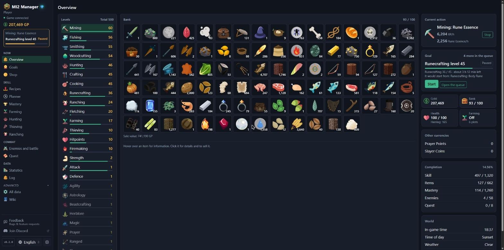
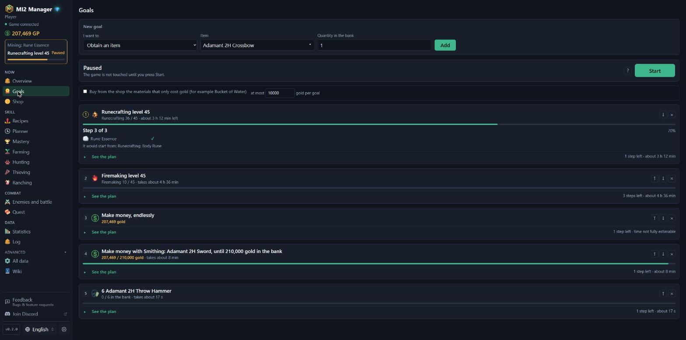
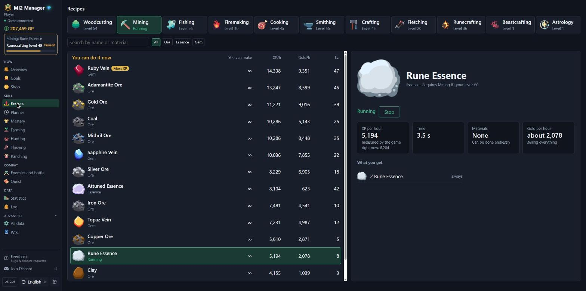

# Melvor Idle 2 Manager

💎 **Want the Supporter features?** → [How to become a Supporter](#how-to-become-a-supporter)

<table>
  <tr>
    <td></td>
    <td></td>
  </tr>
</table>

An unofficial companion app for **Melvor Idle 2**, for Windows. It runs next to the game, shows your progress live
in its own window and can play your goals for you, only when you press Start.

**What it does**

- Live view of your levels, bank, mastery and current action
- Goals: pick a skill level, an item or an amount of gold, and the manager plans the fastest way and plays it for you
- Recipes for every skill with XP and gold per hour, what you can make now and what you're missing
- Combat: which enemies you can beat, with gear, food, style, spells and prayers prepared for you
- Farming, Hunting, Thieving and Ranching pages
- A wiki of items, recipes and enemies, read from your own copy of the game
- Windows notifications when a goal pauses or finishes
- English and Italian, and it updates itself

### Free and Supporter

Everything is free, with **one goal at a time** that runs for up to **2 hours** before you press Start again.

**💎 Supporters** get an unlimited goal queue with no time limit, plus the Gold, Combat, Dungeon and Slayer goals.

### How to become a Supporter

A **one-time donation of at least €5** gives you a lifetime key.

1. Join our Discord: [Secret Library](https://discord.gg/3rUwTUHgdD)
2. Go to **#get-key** and click the button to open a ticket, then pick **Melvor Idle 2 Manager**
3. The bot gives you a code: donate on Ko-fi and paste the code in the donation message
4. Your key arrives in the ticket within a minute
5. In MI2 Manager open **Settings → Supporter key** and paste it

The key is tied to your game account and works on up to 2 PCs. We never DM you first: keys only come from a ticket.

### Install

1. Download **MelvorIdle2Manager-Setup-vX.Y.Z.exe** from the [latest release](https://github.com/ASecretLibrary/MI2Manager/releases/latest).
2. Close the game and run the installer. If Windows says "Windows protected your PC", click **More info → Run anyway**.
3. Open Melvor Idle 2 from Steam: the manager connects by itself.

New versions install themselves: the app only accepts installers signed by us.
This repository only holds the installers and release notes; the source code is private.
Game data, icons and images are read from your own installed copy of the game.

**Help and news:** [join our Discord](https://discord.gg/3rUwTUHgdD).

> ⚠️ **Warning:** MI2 Manager is unofficial and not affiliated with the game's developers. It modifies a game file
> and automates parts of the game. Use it at your own risk.

## Privacy

The manager runs on your PC and reads the game only while both are open. It goes online only for these:

- **Updates:** it asks GitHub whether a new version is out, and installs only signed ones.
- **Supporter key**, only if you enter one: the key, your Steam account (its ID and your Steam display name), your character name and a random ID for this PC go to our licence service, to check the key and limit how many PCs use it.
- **Feedback**, only when you send it: your message, your Discord name if you write it, the app version and settings, your Windows version, the state of the game and of your goals, the same random PC ID and, if you leave the box ticked, the end of the logs (with your Windows user name removed). The window shows all of it before you send. Reports go to a private channel that only our staff can read.

It never sends your save files.
